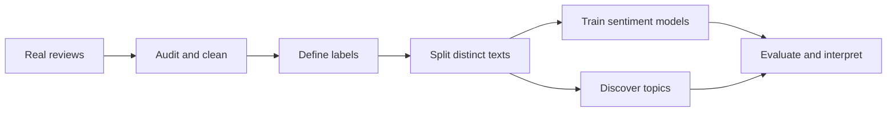

# Azerbaijani Review Analysis — Quick Notes

**Goal:** predict rating-based sentiment and discover review themes.

**1. Dataset **

| Item | Summary |
|---|---|
| Data | 159,422 Azerbaijani reviews |
| Fields | Text, stars, upvotes |
| Tasks | Sentiment classification + topic discovery |
| First action | Check structure; preserve raw data |

**2. Data audit**

| What we checked | What we found / did |
|---|---|
| Missing text | 3 rows; excluded from text modeling |
| Rating balance | Positive reviews dominate |
| Text noise | Informal spelling, emojis, code-switching |
| Duplicates | Many repeated phrases; inspected normalized texts |
| Conflicting ratings | Same text can receive different sentiment labels |

Missingness causes remain uncertain. We did not invent explanations.

**3. Labels and cleaning**

| Stars | Label |
|---|---|
| 1–2 | Negative |
| 3 | Neutral |
| 4–5 | Positive |

| Kept | Normalized |
|---|---|
| Emojis, punctuation, negation | Unicode and whitespace |
| Original review text | Azerbaijani casing for lexical analysis |

**Stars ≠ verified text sentiment.** We inspected mismatches. Assistant audit suggestions are not human annotations.

**4. Split design**

**159,422 rows → 77,107 distinct, non-conflicting texts**

| Preparation | Result |
|---|---:|
| Invalid text removed | 3 rows |
| Conflicting sentiment groups excluded | 657 groups / 68,443 rows |
| Remaining duplicate rows collapsed | 13,869 rows |

| Partition | Distinct texts | Purpose |
|---|---:|---|
| Train | 61,685 | Fit models |
| Validation | 7,711 | Select settings/checkpoints |
| Test | 7,711 | Final evaluation |

Both classifiers used **25,000 training examples**. Normalized-text overlap between splits: **0**.

Results apply to distinct, non-conflicting texts—not all original submissions.

**5. Implementation**

| Model | Role |
|---|---|
| Majority predictor | Minimum reference |
| TF-IDF + logistic regression | Classical baseline |
| XLM-R | Fine-tuned multilingual transformer |

| XLM-R setting | Value |
|---|---|
| Epochs | 3 |
| Learning rate | 2e-5 |
| Maximum length | 128 tokens |
| Batch size | 1 |
| Gradient accumulation | 32 batches |
| Memory control | Gradient checkpointing |
| Imbalance handling | Class-weighted loss; verified at batch size 1 |
| Selected checkpoint | Epoch 2; validation macro-F1 = 0.5801 |

**6. Sentiment results**

| Model | Accuracy | Macro-F1 | Balanced accuracy |
|---|---:|---:|---:|
| Majority | 73.05% | 0.2814 | 33.33% |
| TF-IDF | 77.86% | 0.5591 | 58.86% |
| **XLM-R** | **78.63%** | **0.5763** | **61.69%** |

**Finding:** XLM-R improves modestly over TF-IDF: **+0.0173 macro-F1**.

| XLM-R class | F1 | Interpretation |
|---|---:|---|
| Negative | 0.7109 | Stronger than neutral |
| Neutral | 0.1447 | Main weakness |
| Positive | 0.8734 | Best-performing class |

Neutral recall: **25.18% — 69 of 274 correctly identified.**

Macro-F1 gives each class equal importance. Accuracy alone hides weak neutral performance.

**7. Topics**

**Gensim LDA:** compared 5, 8 and 12 topics → selected **5** using validation coherence.

| Theme | What users discuss |
|---|---|
| Access failures | Login, registration, crashes |
| Payment/service problems | Transfers, orders, delivery |
| Convenience and praise | Useful features, easier payments, time savings |
| Feature requests | Updates, bonuses, extra functionality |
| Mixed informal feedback | Complaints and help requests across services |

| Topic | Negative-rated texts | Positive-rated texts |
|---|---:|---:|
| Access/failures | 30.9% | 14.5% |
| Convenience/praise | 17.7% | 37.4% |

Values are **average topic probabilities among covered texts**, not percentages assigned to a single issue.

| Topic-analysis coverage | Negative | Neutral | Positive |
|---|---:|---:|---:|
| After vocabulary/length filtering | 91.8% | 88.0% | 71.0% |

We read distinct examples and checked a second random seed. Some themes remained mixed or unstable.

**8. Conclusions**

| What worked | What remains limited |
|---|---|
| Complete sentiment + topic pipeline | Ratings are noisy labels |
| Transformer beats both baselines | Improvement is modest |
| Duplicate-safe evaluation | Exclusions change the evaluated population |
| Useful complaint/praise themes | Topic coverage and stability vary |
| Per-class reporting | Neutral sentiment remains difficult |

